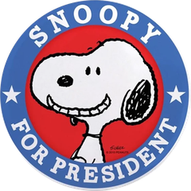

<samp>applied ai × research &nbsp;·&nbsp; jaipur, india</samp>

<samp>cs undergrad at manipal ('28), building things that make life a little simpler. right now i'm a <b>cpp-2 research intern at hpe</b> and an <b>ai engineer at sylus ai</b>. before this, <b>amazon ml summer school '26</b> and llm safety research at the ai² lab, muj.</samp>

<samp>i also ship products. <a href="https://petal.aryy.in">petal</a> is a pdf editor you just talk to. <a href="https://mingraph.aryy.in">mingraph</a> finds paths across every road in jaipur. <a href="https://lattice.aryy.in">lattice</a> makes text sound human, and somehow reached <b>400+ people in 52 countries</b>. <a href="https://texlab.aryy.in">texlab</a> is for when you'd rather describe a latex diagram than draw it.</samp>

&nbsp;&nbsp;&nbsp;&nbsp;&nbsp;&nbsp;&nbsp;&nbsp;&nbsp;&nbsp;&nbsp;&nbsp;&nbsp;&nbsp;&nbsp;&nbsp;<picture><source media="(prefers-color-scheme: dark)" srcset="assets/nextjs-dark.svg" /></picture>&nbsp;&nbsp;&nbsp;&nbsp;&nbsp;&nbsp;&nbsp;&nbsp;&nbsp;&nbsp;&nbsp;&nbsp;

<samp><a href="https://aryy.in">aryy.in</a> &nbsp;·&nbsp; <a href="https://www.linkedin.com/in/aryy8">linkedin</a> &nbsp;·&nbsp; <a href="https://x.com/aryyann8">x</a></samp>
