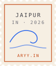

<table>
<tr>
<td width="300" valign="top">

</td>
<td valign="top">

Hi, I'm Aryan, a CS student at Manipal (class of '28).

**currently surfing:**
CPP-2 at HPE, AI engineering at Sylus AI, Amazon ML Summer School '26, and LLM safety research at the AI² Lab, MUJ.

**things I've shipped:**
[Petal](https://petal.aryy.in), a PDF editor you just talk to. [MinGraph](https://mingraph.aryy.in), pathfinding across every road in Jaipur. [Lattice](https://lattice.aryy.in), which makes text sound natural and somehow reached 400+ people in 52 countries. And [teXlab](https://texlab.aryy.in), for when you'd rather describe a LaTeX diagram than draw it.

*— aryan*

<code>POSTMARKED JAIPUR · IN · 2026</code>

</td>
</tr>
</table>

[aryy.in](https://aryy.in) · [linkedin.com/in/aryy8](https://linkedin.com/in/aryy8) · [x.com/aryyann8](https://x.com/aryyann8)
